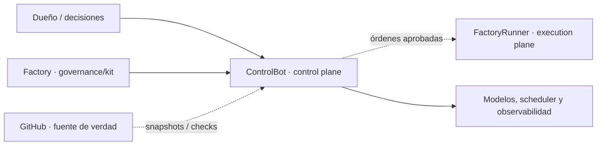

# ControlBot

> Centro de control web **privado** de la fábrica de software asistida por IA.

**Rol en la fábrica:** control plane privado · **Fase:** construcción · **Roadmap:** [épico canónico #1](https://github.com/pl0n3r/ControlBot/issues/1)

ControlBot mantiene el modelo operativo de proyectos, agentes, trabajo, decisiones, producción e incidentes. Factory aporta gobernanza; GitHub conserva la fuente de verdad del ciclo de código; FactoryRunner ejecuta trabajo autorizado y AutoFactory sigue como herramienta local/manual separada.

## Operational Cockpit

[](https://github.com/pl0n3r/ControlBot/actions/workflows/ci.yml)
[](https://github.com/pl0n3r/ControlBot/releases)

[GitHub Actions](https://github.com/pl0n3r/ControlBot/actions) · [GitHub Releases](https://github.com/pl0n3r/ControlBot/releases) · [Orquestador de ControlBot](https://control.condorapp.com.co/) (panel privado, no acredita sitio operativo).

El [health owner-gated de #817](https://github.com/pl0n3r/ControlBot/issues/817) está preparado como contrato offline, pero **no hay un `/health` público productivo acreditado**. Los badges se actualizan al visualizar GitHub, sin commits de refresco ni porcentajes de progreso.

## Work Queue

- **NOW:** [Issues abiertos con reservas y revisiones](https://github.com/pl0n3r/ControlBot/issues) — comprobar claims y checks en GitHub antes de actuar.
- **NEXT:** [Issues críticos disponibles](https://github.com/pl0n3r/ControlBot/issues?q=is%3Aissue+is%3Aopen+label%3A%22prioridad%3A+cr%C3%ADtica%22+label%3A%22estado%3A+disponible%22), según Coordinación y dependencias.
- **LATER:** [épico y planificación canónica #1](https://github.com/pl0n3r/ControlBot/issues/1).
- **BLOCKED:** [sitio/go-live #625](https://github.com/pl0n3r/ControlBot/issues/625) requiere backup real conforme a [D-059](docs/hostinger-d059-backup.md) y puertas del dueño.

Esta vista resume la cola y enlaza sus fuentes; el README no concede reservas ni sustituye Issues, CI o decisiones.

## Qué hace el producto

ControlBot es el **control plane** de la fábrica, con componentes versionados para:

- [decisiones y puertas del dueño](src/DecisionRuntime.php), [inbox](src/OwnerInbox.php) y registro de acciones;
- [proyección GitHub read-only](docs/github-control-plane-readonly-v1.md) y contratos de [evidencia de intenciones](docs/github-intent-policy-v1.md), que no conceden ejecución por inferencia;
- [modelos de proyectos](src/ProjectModel.php), [agentes](src/AgentRuntime.php), [scheduler](src/SchedulerSelection.php) y [estado de trabajos](src/WorkInventorySnapshot.php);
- [observación de reservas V3](docs/observador-reservas-consumidor.md) GET-only (sin liberar leases automáticamente) y [observabilidad pública de solo lectura](docs/factory-public-health-observability.md), sin productor live conectado.

La presencia de contratos y tests en `main` **no acredita despliegue**: el sitio está sujeto a [#625](https://github.com/pl0n3r/ControlBot/issues/625) y la puerta D-059.

## Arquitectura en 60 segundos



Las conexiones punteadas representan [contratos y proyecciones](docs/github-control-plane-readonly-v1.md), **no acciones remotas habilitadas**. [FactoryRunner](https://github.com/pl0n3r/FactoryRunner) ejecuta trabajo gobernado; [AutoFactory](https://github.com/pl0n3r/AutoFactory) sigue local/manual e independiente.

## Stack e infraestructura

- **Stack declarado:** [PHP 8.5 + MariaDB](AGENTES.md), [GitHub Actions](.github/workflows/ci.yml) y Hostinger shared hosting como destino; app, DB y deploy independientes.
- **Coordinación y policy:** [Factory@v1](.github/workflows/coordinacion.yml), con reservas V3, roles, aceptación y checks reproducibles.
- **Control plane GitHub:** [snapshots solo lectura](src/GitHubProjectSnapshot.php), [políticas de intención](src/GitHubIntentPolicy.php) y adapters sujetos a permisos explícitos.
- **Operación/health:** [identidad owner-gated #817](https://github.com/pl0n3r/ControlBot/issues/817) y [observador V3](docs/observador-reservas-consumidor.md) en fase de construcción; ninguno prueba salud pública live.
- **Despliegue:** [backup/restauración D-059](docs/hostinger-d059-backup.md) antes de tocar Hostinger; sin asumir cron, DB, credenciales o servicio habilitados.

El panel requiere acceso restringido; el repositorio de código es público según [D-062](decisiones.yml).

## Ciclo de entrega

Issue → `/tomar` → rama canónica → implementación → PR → Factory CI/aceptación/revisión → merge → release/deploy cuando aplique → smoke/observer → evidencia.

Un merge no equivale a go-live ni a producción validada. Las acciones de infraestructura respetan backup, rollback, trazabilidad y puertas humanas vigentes.

## Calidad y seguridad

- Factory v1 gobierna CI, coordinación, aceptación, roles, etiquetas, release, política y privacidad.
- Estado desconocido falla cerrado; no se inventan señales operativas.
- Acceso del dueño con autenticación fuerte, CSRF, rate limiting y sesiones cortas.
- Tokens de GitHub/Sentry y credenciales viven fuera del repositorio.
- La API del puente acepta llaves por perfil emparejadas y revocables.
- Login, captcha y verificaciones de cuentas web los realiza manualmente el dueño.
- Toda acción relevante deja bitácora y las escrituras de infraestructura siguen `decisiones.yml`.

## Roadmap y fuentes de verdad

- [Roadmap/épico ControlBot #1](https://github.com/pl0n3r/ControlBot/issues/1) y [GitHub Issues](https://github.com/pl0n3r/ControlBot/issues): planificación y claims.
- [PRs](https://github.com/pl0n3r/ControlBot/pulls), [CI](https://github.com/pl0n3r/ControlBot/actions) y [Releases](https://github.com/pl0n3r/ControlBot/releases): evidencia verificable exact-HEAD.
- [PLAN-AGENTES.md](https://github.com/pl0n3r/factory/blob/main/PLAN-AGENTES.md) y [AGENTES.md](AGENTES.md): gobernanza y contrato técnico.
- [decisiones.yml](decisiones.yml) y [datos.yml](datos.yml): autoridades y tratamiento.
- [docs/](docs/): contratos, runbooks y límites; [#817](https://github.com/pl0n3r/ControlBot/issues/817) identifica la preparación de health, [#625](https://github.com/pl0n3r/ControlBot/issues/625) el despliegue pendiente.

La evidencia operativa se consulta en sus fuentes, no se recrea como tabla estática de progreso en el README.

## Desarrollo local

El repositorio usa regresiones Python que ejercitan contratos y escenarios PHP. La validación reproducible principal es:

```bash
python3 -m unittest discover -s tests -p 'test_*.py'
```

Los escenarios PHP requieren PHP 8.5, la misma versión fijada por CI.

## Mapa de la fábrica

- **Factory:** governance/kit y contratos compartidos.
- **ControlBot:** control plane privado de orquestación, decisiones, observabilidad y UX del dueño.
- **FactoryRunner:** execution plane autónomo que materializa órdenes autorizadas.
- **AutoFactory:** herramienta local/manual y puente externo estable; no es el scheduler de ControlBot.
- **Condor / GrindFlow / BRVTAL:** productos independientes con sus propios datos, runtime y deploy.

La elegibilidad en la cola automática no altera estas responsabilidades.

## Inbox de decisiones

El inbox descubre puertas humanas abiertas y confiables en los repos configurados, recorre Issues con paginación acotada y falla cerrado si no puede completar la lectura. Para `factory-release`, conserva SHA exacto de `main`, checks y evidencia antes de permitir una acción.

## Runtime privado de decisiones

El runtime resuelve las acciones del dueño desde contexto server-side, inyecta CSRF, conserva correlación de release y delega mutaciones solo a adapters gobernados. No convierte el dashboard en una cabina pública ni amplía la autoridad del agente.

## Historial y bitácora

ControlBot reutiliza una bitácora append-only para exponer historial privado por decisión y filtros server-side. La salida minimiza datos, conserva evidencia HTTPS allowlisted y mantiene prioridad para puertas que bloquean producción o trabajo.
